# NLP - Classification and Vector Spaces
<div align="center">

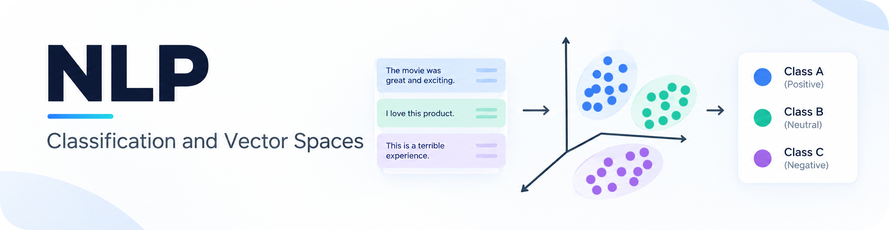


[](https://www.python.org/)
[](https://jupyter.org/)
[](https://numpy.org/)
[](https://pandas.pydata.org/)
[](https://scipy.org/)
[](https://www.nltk.org/)

[](https://www.deeplearning.ai/)
[](https://www.coursera.org/account/accomplishments/specialization/VY569JPZ3TZE)
[](https://github.com/mohd-faizy/nlp-classification-and-vector-spaces/stargazers)
[](https://github.com/mohd-faizy/nlp-classification-and-vector-spaces/network/members)
[](https://github.com/mohd-faizy/nlp-classification-and-vector-spaces)
[](https://opensource.org/licenses/MIT)

*Taught by Younes Bensouda Mourri, Łukasz Kaiser, and Eddy Shyu*

[**Verify Specialization Certificate (VY569JPZ3TZE)**](https://www.coursera.org/account/accomplishments/specialization/VY569JPZ3TZE)

</div>

---

## 📌 Overview

Welcome to the official repository for **NLP - Classification and Vector Spaces**, the first course in the [Natural Language Processing Specialization](https://www.coursera.org/specializations/natural-language-processing) by [DeepLearning.AI](https://www.deeplearning.ai/) on [Coursera](https://www.coursera.org/learn/classification-vector-spaces-in-nlp).

This course covers foundational natural language processing algorithms and representations:
- **Sentiment Analysis with Logistic Regression**: Preprocessing tweets with stemming and stopword removal, extracting positive/negative frequency features, and training via gradient descent.
- **Sentiment Analysis with Naïve Bayes**: Probability modeling, Laplace add-1 smoothing, log likelihood, and log prior ratios with error analysis.
- **Vector Space Models & Word Embeddings**: Continuous representations, word-by-word and word-by-document co-occurrence, Cosine similarity, and dimensionality reduction via Principal Component Analysis (PCA).
- **Machine Translation & Document Search**: Aligning word vector spaces across languages using transformation matrices, Frobenius norm loss, and Locality Sensitive Hashing (LSH) for approximate nearest neighbor retrieval.

---

## 📑 Table of Contents

- [📌 Overview](#-overview)
- [📑 Table of Contents](#-table-of-contents)
- [📂 Repository Structure](#-repository-structure)
- [📑 Weekly Curriculum & Notebook Index](#-weekly-curriculum--notebook-index)
- [🚀 Getting Started & Installation](#-getting-started--installation)
  - [1. Prerequisites](#1-prerequisites)
  - [2. Clone the Repository](#2-clone-the-repository)
  - [3. Create a Virtual Environment](#3-create-a-virtual-environment)
  - [4. Install Dependencies](#4-install-dependencies)
  - [5. Launch Jupyter Lab / Notebook](#5-launch-jupyter-lab--notebook)
- [🧠 Comprehensive Lecture Notes & Mathematical Foundations](#-comprehensive-lecture-notes--mathematical-foundations)
  - [Part 1: Sentiment Analysis with Logistic Regression](#part-1-sentiment-analysis-with-logistic-regression)
    - [1.1 Supervised Machine Learning & Sentiment Classification](#11-supervised-machine-learning--sentiment-classification)
    - [1.2 Feature Extraction: Sparse Representation vs. Frequency Counts](#12-feature-extraction-sparse-representation-vs-frequency-counts)
    - [1.3 Text Preprocessing Pipeline](#13-text-preprocessing-pipeline)
    - [1.4 Training Logistic Regression via Gradient Descent](#14-training-logistic-regression-via-gradient-descent)
    - [1.5 Cost Function & Binary Cross-Entropy Loss](#15-cost-function--binary-cross-entropy-loss)
    - [1.6 Testing, Decision Boundary & Validation](#16-testing-decision-boundary--validation)
  - [Part 2: Sentiment Analysis with Naïve Bayes](#part-2-sentiment-analysis-with-naïve-bayes)
    - [2.1 Conditional Probability & Foundations](#21-conditional-probability--foundations)
    - [2.2 Bayes' Rule for Text Classification](#22-bayes-rule-for-text-classification)
    - [2.3 Laplacian (Add-1) Smoothing](#23-laplacian-add-1-smoothing)
    - [2.4 Ratio of Probabilities & Likelihood Ratios](#24-ratio-of-probabilities--likelihood-ratios)
    - [2.5 Likelihood Product & Prior Odds](#25-likelihood-product--prior-odds)
    - [2.6 Log Likelihood and Log Prior Formulation](#26-log-likelihood-and-log-prior-formulation)
    - [2.7 End-to-End Training Algorithm for Naïve Bayes](#27-end-to-end-training-algorithm-for-naïve-bayes)
    - [2.8 Testing, Inference & Scoring Algorithm](#28-testing-inference--scoring-algorithm)
    - [2.9 Real-World Applications of Naïve Bayes](#29-real-world-applications-of-naïve-bayes)
    - [2.10 Core Assumptions & Error Analysis](#210-core-assumptions--error-analysis)
  - [Part 3: Vector Space Models & Word Embeddings](#part-3-vector-space-models--word-embeddings)
    - [3.1 Vector Space Models & Distributional Semantics](#31-vector-space-models--distributional-semantics)
    - [3.2 Word-by-Word Co-occurrence Matrix Design](#32-word-by-word-co-occurrence-matrix-design)
    - [3.3 Word-by-Document Co-occurrence Matrix Design](#33-word-by-document-co-occurrence-matrix-design)
    - [3.4 Vector Distance Metrics: Euclidean Distance & Its Limitations](#34-vector-distance-metrics-euclidean-distance--its-limitations)
    - [3.5 Cosine Similarity & Angular Metric](#35-cosine-similarity--angular-metric)
    - [3.6 Vector Space Manipulation & Semantic Analogies](#36-vector-space-manipulation--semantic-analogies)
    - [3.7 Principal Component Analysis (PCA) Algorithm & Dimensionality Reduction](#37-principal-component-analysis-pca-algorithm--dimensionality-reduction)
  - [Part 4: Machine Translation & Document Search](#part-4-machine-translation--document-search)
    - [4.1 Document Vector Representations](#41-document-vector-representations)
    - [4.2 Cross-Lingual Word Vector Transformation](#42-cross-lingual-word-vector-transformation)
    - [4.3 Loss Function & Optimization (Frobenius Norm Loss)](#43-loss-function--optimization-frobenius-norm-loss)
    - [4.4 K-Nearest Neighbors (KNN) & Search Bottlenecks](#44-k-nearest-neighbors-knn--search-bottlenecks)
    - [4.5 Hash Tables and Basic Hash Functions](#45-hash-tables-and-basic-hash-functions)
    - [4.6 Locality Sensitive Hashing (LSH) & Random Hyperplanes](#46-locality-sensitive-hashing-lsh--random-hyperplanes)
    - [4.7 Hyperplane Normal Dot Products & Binary Hash Encoding](#47-hyperplane-normal-dot-products--binary-hash-encoding)
    - [4.8 Approximate Nearest Neighbors (ANN) & Multi-Table Search](#48-approximate-nearest-neighbors-ann--multi-table-search)
- [📜 License](#-license)

---

## 📂 Repository Structure

All 13 interactive notebooks are located at the root directory, sequentially numbered from `01_` to `13_` following the course trajectory. Supporting data, media assets, and lecture materials are modularly organized into dedicated subdirectories:

```text
├── 📓 Notebooks (Sequentially Numbered)
│   ├── 01_tweet_preprocessing.ipynb                          # Stemming, tokenization & stopwords
│   ├── 02_visualizing_word_frequencies.ipynb                 # Word frequency dictionaries
│   ├── 03_visualizing_decision_boundary.ipynb                # Logistic regression decision boundary
│   ├── 04_logistic_regression_sentiment_analysis.ipynb       # Logistic Regression Classifier
│   ├── 05_visualizing_naive_bayes_confidence_ellipses.ipynb  # Naïve Bayes confidence ellipses
│   ├── 06_naive_bayes_sentiment_analysis.ipynb               # Naïve Bayes Sentiment Classifier
│   ├── 07_numpy_linear_algebra_foundations.ipynb             # Linear algebra with NumPy
│   ├── 08_word_embeddings_and_vector_manipulation.ipynb      # Word vectors & cosine similarity
│   ├── 09_pca_dimensionality_reduction.ipynb                 # PCA step-by-step projection
│   ├── 10_vector_spaces_and_word_analogies.ipynb             # Word Analogies & PCA Visuals
│   ├── 11_vector_rotations_and_transformations.ipynb         # 2D vector transformations & rotations
│   ├── 12_hash_tables_and_locality_sensitive_hashing.ipynb   # Hash tables & random hyperplanes
│   └── 13_machine_translation_and_document_search.ipynb # Translation Matrix & LSH Search
│
├── 📁 utils/                           # Core utilities & helper modules package
│   ├── __init__.py                     # Package initialization & consolidated re-exports
│   ├── utils.py                        # Unified utility module (tweet processing, build_freqs, PCA, cosine)
│   ├── utils_nb.py                     # Visualization helpers (vector arrow plotting)
│   └── utils_vecs.py                   # Word vector translation utilities
│
├── 📁 data/                            # Organized dataset subfolders
│   ├── features/                       # Extracted sentiment frequency feature tables
│   │   ├── logistic_regression_features.csv
│   │   └── naive_bayes_features.csv
│   ├── embeddings/                     # Word vector embeddings dictionaries
│   │   ├── english_word_embeddings_subset.p
│   │   ├── english_word_embeddings.p
│   │   └── french_word_embeddings.p
│   ├── dictionaries/                   # Translation pairs & analogy datasets
│   │   ├── country_capitals.txt
│   │   ├── english_french_dictionary.txt
│   │   ├── english_french_translation_train.txt
│   │   └── english_french_translation_test.txt
│   ├── corpora/                        # Pre-downloaded NLTK stopwords corpora
│   │   └── nltk_stopwords/corpora/stopwords/
│   └── README.md                       # Comprehensive data catalog
│
├── 🖼️ assets/                          # Standardized, numbered figures and diagrams
│   ├── banner.png                      # Course title banner
│   ├── fig_01_supervised_learning_cost_minimization.png ...
│   ├── fig_44_laplace_smoothing_probability_table.png
│   ├── sigmoid_activation_plot.jpg     # Sigmoid plot for Week 1 assignment
│   ├── confidence_ellipses.jpg          # Confidence ellipses for Week 2 lecture
│   ├── world_map_capitals.jpg ... gaussian_scatter_pca.png
│   └── english_french_translation.jpg ... vector_transform_rotation.svg
│
│
├── requirements.txt                    # Environment dependencies
├── .gitignore                          # Clean repository ignore rules
└── README.md                           # Main documentation
```

---

## 📑 Weekly Curriculum & Notebook Index

| Week | Focus Topic | Primary Assignment | Lecture Notebooks | Lecture Slides |
|:---:|---|---|---|:---:|
| **1** | **Sentiment Analysis with Logistic Regression** | [`04_logistic_regression_sentiment_analysis.ipynb`](./04_logistic_regression_sentiment_analysis.ipynb) | • [`01_tweet_preprocessing.ipynb`](./01_tweet_preprocessing.ipynb) (Preprocessing)<br>• [`02_visualizing_word_frequencies.ipynb`](./02_visualizing_word_frequencies.ipynb) (Frequencies)<br>• [`03_visualizing_decision_boundary.ipynb`](./03_visualizing_decision_boundary.ipynb) (Decision Boundary) | [Slide Deck 1](./lectures/1-sentiment%20analysis%20with%20logistic%20regression.pdf) |
| **2** | **Sentiment Analysis with Naïve Bayes** | [`06_naive_bayes_sentiment_analysis.ipynb`](./06_naive_bayes_sentiment_analysis.ipynb) | • [`05_visualizing_naive_bayes_confidence_ellipses.ipynb`](./05_visualizing_naive_bayes_confidence_ellipses.ipynb) (Confidence Ellipses) | [Slide Deck 2](./lectures/2-sentiment%20analysis%20with%20naive%20bayes.pdf) |
| **3** | **Vector Space Models & Word Embeddings** | [`10_vector_spaces_and_word_analogies.ipynb`](./10_vector_spaces_and_word_analogies.ipynb) | • [`07_numpy_linear_algebra_foundations.ipynb`](./07_numpy_linear_algebra_foundations.ipynb) (NumPy Foundations)<br>• [`08_word_embeddings_and_vector_manipulation.ipynb`](./08_word_embeddings_and_vector_manipulation.ipynb) (Word Embeddings)<br>• [`09_pca_dimensionality_reduction.ipynb`](./09_pca_dimensionality_reduction.ipynb) (PCA Projection) | [Slide Deck 3](./lectures/3-vector%20space%20models.pdf) |
| **4** | **Machine Translation & Document Search** | [`13_machine_translation_and_document_search.ipynb`](./13_machine_translation_and_document_search.ipynb) | • [`11_vector_rotations_and_transformations.ipynb`](./11_vector_rotations_and_transformations.ipynb) (Vector Rotations)<br>• [`12_hash_tables_and_locality_sensitive_hashing.ipynb`](./12_hash_tables_and_locality_sensitive_hashing.ipynb) (Locality Sensitive Hashing) | [Slide Deck 4](./lectures/4-machine%20translation%20and%20document%20search.pdf) |

---

## 🚀 Getting Started & Installation

### 1. Prerequisites
Ensure you have **Python 3.8+** installed on your system.

### 2. Clone the Repository
```bash
git clone https://github.com/mohd-faizy/nlp-classification-and-vector-spaces.git
cd nlp-classification-and-vector-spaces
```

### 3. Create a Virtual Environment
```bash
# macOS/Linux
python3 -m venv venv
source venv/bin/activate

# Windows (PowerShell)
python -m venv venv
.\venv\Scripts\Activate.ps1
```

### 4. Install Dependencies
```bash
pip install -r requirements.txt
```

### 5. Launch Jupyter Lab / Notebook
```bash
jupyter notebook
```
Open any of the sequentially numbered `.ipynb` notebooks (`01_` through `13_`) to run the code interactively. All paths to `data/` subfolders and `assets/` figures are pre-configured to execute out-of-the-box from the root workspace.

---

## 🧠 Comprehensive Lecture Notes & Mathematical Foundations

---

### Part 1: Sentiment Analysis with Logistic Regression

#### 1.1 Supervised Machine Learning & Sentiment Classification
- **Supervised Learning Formulation**:
  - The dataset consists of feature-label pairs: $\{ (x^{(1)}, y^{(1)}), (x^{(2)}, y^{(2)}), \dots, (x^{(m)}, y^{(m)}) \}$, where $x^{(i)} \in \mathbb{R}^d$ is the extracted feature vector and $y^{(i)} \in \{0, 1\}$ is the ground-truth binary sentiment label.
  - In Twitter sentiment classification, positive sentiment tweets are assigned the label $y = 1$, and negative sentiment tweets are assigned the label $y = 0$.
- **Hypothesis and Optimization Goal**:
  - The objective is to learn a mapping function $\hat{y} = h_\theta(x)$ parameterized by weights $\theta$ that accurately predicts the true class label.
  - The optimization goal is to minimize a designated cost function $J(\theta)$ measuring the discrepancy between expected targets $Y$ and model predictions $\hat{Y}$.
  - Model weights $\theta$ are iteratively adjusted via optimization algorithms (such as gradient descent) until the cost function reaches a minimum.
  - 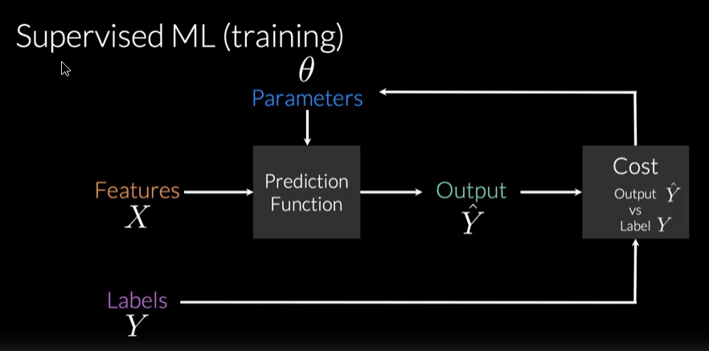
- **Sigmoid Activation Function**:
  - In logistic regression, the linear combination $z = \theta^T x = \theta_0 x_0 + \theta_1 x_1 + \dots + \theta_n x_n$ is passed through the sigmoid (logistic) function:
    $$h(z) = \frac{1}{1 + e^{-z}}$$
  - The sigmoid function maps any real number $z \in (-\infty, \infty)$ to the bounded probability interval $(0, 1)$.
  - **Asymptotic Behavior**:
    - As $z \to \infty$, $e^{-z} \to 0 \implies h(z) \to 1$.
    - As $z \to -\infty$, $e^{-z} \to \infty \implies h(z) \to 0$.
    - At $z = 0$, $e^{0} = 1 \implies h(z) = 0.5$ (the default classification threshold).
  - 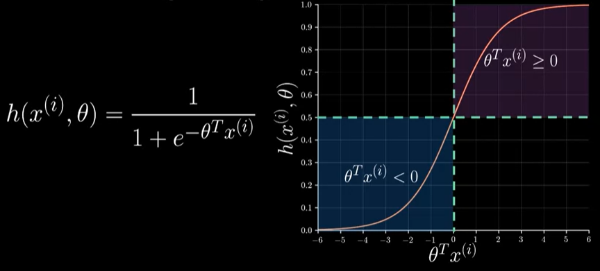
- **Three-Step Sentiment Classification Pipeline**:
  - **Step 1: Feature Extraction**: Preprocess raw text and map variable-length tweets into fixed-dimensional numerical feature vectors $x^{(i)}$.
  - **Step 2: Model Training**: Fit the logistic regression parameters $\theta$ by minimizing the binary cross-entropy loss over the training dataset.
  - **Step 3: Prediction & Evaluation**: Apply the learned parameters $\theta$ to predict sentiment labels for unseen tweets and evaluate validation accuracy.
  - 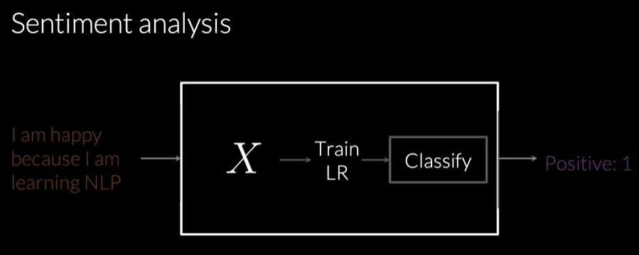

---

#### 1.2 Feature Extraction: Sparse Representation vs. Frequency Counts
- **Method 1: Sparse Vector Representation (Bag-of-Words)**:
  - Construct a comprehensive vocabulary $V$ containing all unique tokens across the entire corpus of size $|V|$.
  - Encode each tweet as a vector of length $|V|$, placing a $1$ at index $j$ if word $w_j \in V$ appears in the tweet, and $0$ otherwise.
  - 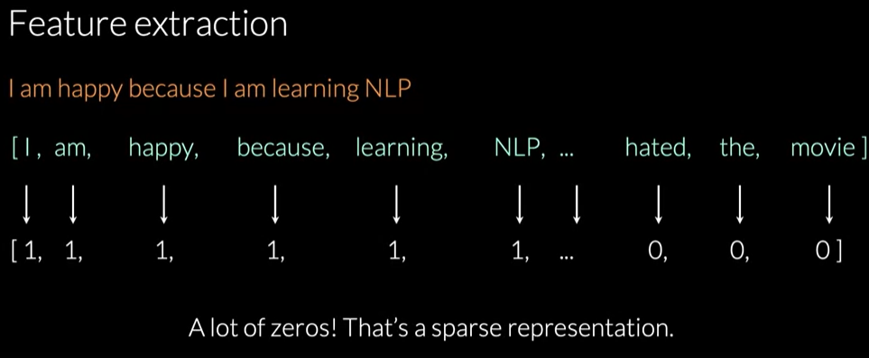
  - **Critical Drawbacks of Sparse Representations**:
    - **High Dimensionality**: For realistic vocabularies ($|V| \ge 10^4$ to $10^6$), the model must learn $|V| + 1$ parameters.
    - **Extreme Sparsity**: A single tweet typically contains only $10$ to $30$ words, meaning $>99.9\%$ of the vector entries are zeroes.
    - **Prohibitive Computational Cost**: Results in excessive memory consumption, prolonged training times, and slow real-time inference latency.
    - 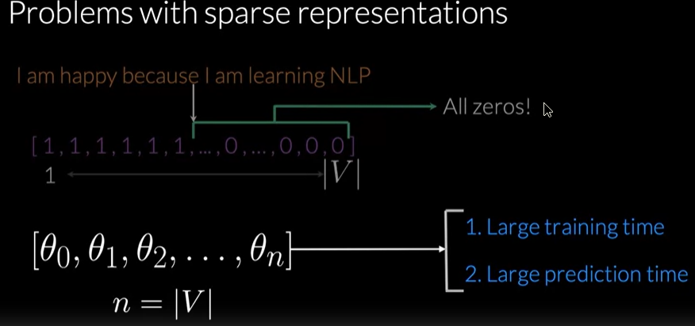
- **Method 2: Sentiment Frequency Dictionaries (Compact 3D Vector)**:
  - **Frequency Mapping**: Construct a global dictionary `freqs` mapping every `(word, class)` tuple to its occurrence count in the training corpus:
    - $\text{freq}(w, 1)$: Number of times word $w$ appears in positive tweets.
    - $\text{freq}(w, 0)$: Number of times word $w$ appears in negative tweets.
  - 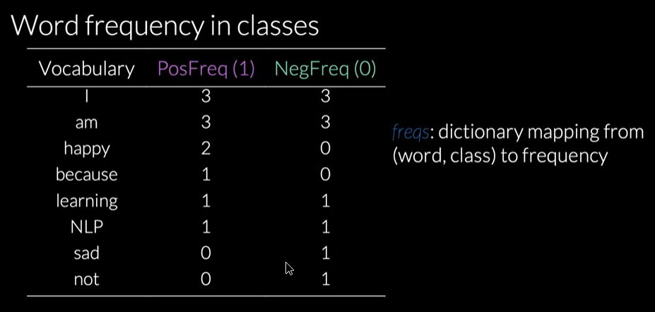
  - **Compact 3D Feature Vector Construction**:
    - Each tweet is represented by a fixed 3-element vector $x^{(i)} \in \mathbb{R}^3$:
      $$x^{(i)} = \begin{bmatrix} 1 \\ \sum_{w} \text{freq}(w, 1) \\ \sum_{w} \text{freq}(w, 0) \end{bmatrix}$$
    - $x_0 = 1$: Constant bias intercept term.
    - $x_1 = \sum_{w \in \text{tweet}} \text{freq}(w, 1)$: Sum of positive frequencies for all unique preprocessed words in the tweet.
    - $x_2 = \sum_{w \in \text{tweet}} \text{freq}(w, 0)$: Sum of negative frequencies for all unique preprocessed words in the tweet.
  - **Key Advantages**:
    - Reduces feature dimensionality from thousands of dimensions ($|V|$) down to exactly $3$ dimensions.
    - Vastly accelerates gradient descent training and enables instantaneous predictions with minimal memory footprint.
  - 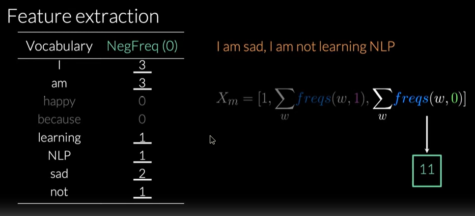

---

#### 1.3 Text Preprocessing Pipeline
- **Motivation**:
  - Raw social media text contains abundant noise, typos, slang, punctuation, URLs, and formatting variations that distort frequency statistics.
- **Sequential Preprocessing Steps**:
  - **1. Lowercasing**: Convert all characters to lowercase to treat "HAPPY", "Happy", and "happy" as the same token.
  - **2. Regex Cleaning**: Strip non-semantic elements such as Twitter handles (`@username`), web URLs (`https://...`), and retweet tags (`RT`).
  - **3. Tokenization**: Split text strings into individual tokens using `nltk.tokenize.TweetTokenizer`, which preserves emoticons (`:)`, `:(`) while isolating words.
  - **4. Stopword Removal**: Filter out frequent grammatical words (e.g., "and", "is", "the", "at", "on") from the NLTK English stopwords list that carry no distinct sentiment signal.
  - **5. Punctuation Filtering**: Remove non-informative punctuation marks while preserving meaningful sentiment-bearing emoticons.
  - **6. Stemming**: Apply the Porter Stemmer (`nltk.stem.PorterStemmer`) to reduce inflected or derived words to their base stem (e.g., "tuning", "tuned", "tuner" $\to$ "tune").
- 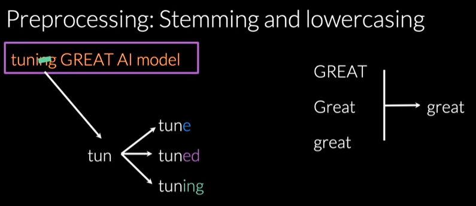

---

#### 1.4 Training Logistic Regression via Gradient Descent
- **Model Hypothesis**:
  - For a feature vector $x^{(i)}$ and parameter weights $\theta = [\theta_0, \theta_1, \theta_2]^T$, the model predicts:
    $$h_\theta(x^{(i)}) = \sigma(\theta^T x^{(i)}) = \frac{1}{1 + \exp(-\theta^T x^{(i)})}$$
- **Batch Gradient Descent Algorithm**:
  - **Step 1**: Initialize parameter vector $\theta$ to zeros or small random values: $\theta = [0, 0, 0]^T$.
  - **Step 2**: Compute predicted probabilities $\hat{Y} = \sigma(X\theta)$ for all $m$ training samples simultaneously.
  - **Step 3**: Compute the gradient vector of the cost function with respect to $\theta$:
    $$\nabla_\theta J(\theta) = \frac{1}{m} X^T (\hat{Y} - Y)$$
  - **Step 4**: Update parameters in the direction opposite to the gradient scaled by learning rate $\alpha$:
    $$\theta \leftarrow \theta - \alpha \cdot \frac{1}{m} X^T (\hat{Y} - Y)$$
  - **Step 5**: Repeat Steps 2 through 4 for a predefined number of iterations or until the change in cost $\|J_{\text{new}} - J_{\text{old}}\|$ falls below a convergence tolerance.
- 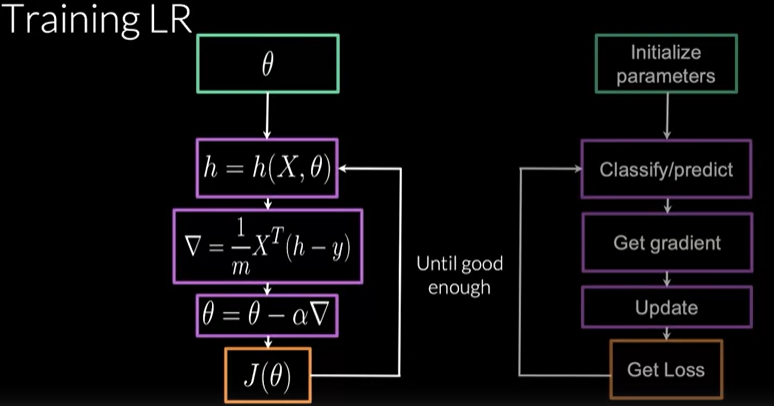

---

#### 1.5 Cost Function & Binary Cross-Entropy Loss
- **Mathematical Definition**:
  - The binary cross-entropy loss over $m$ training instances is defined as:
    $$J(\theta) = -\frac{1}{m} \sum_{i=1}^{m} \left[ y^{(i)} \log(h_\theta(x^{(i)})) + (1 - y^{(i)}) \log(1 - h_\theta(x^{(i)})) \right]$$
- **Loss Intuition by True Label**:
  - **Case 1: Ground Truth $y^{(i)} = 1$**:
    - The second term drops out, leaving $-\log(\hat{y})$.
    - If $\hat{y} \to 1$, $-\log(\hat{y}) \to 0$ (near zero penalty for correct confident prediction).
    - If $\hat{y} \to 0$, $-\log(\hat{y}) \to \infty$ (infinite penalty for predicting negative sentiment when actual is positive).
  - **Case 2: Ground Truth $y^{(i)} = 0$**:
    - The first term drops out, leaving $-\log(1 - \hat{y})$.
    - If $\hat{y} \to 0$, $-\log(1 - \hat{y}) \to 0$ (near zero penalty for correct confident prediction).
    - If $\hat{y} \to 1$, $-\log(1 - \hat{y}) \to \infty$ (infinite penalty for predicting positive sentiment when actual is negative).
- **Convexity Guarantee**:
  - Binary cross-entropy is strictly convex with respect to $\theta$ for logistic regression, ensuring gradient descent will not become trapped in local minima and will converge to the global minimum.
- 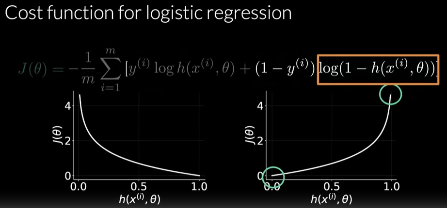

---

#### 1.6 Testing, Decision Boundary & Validation
- **Validation Dataset**:
  - Model generalization is evaluated on held-out validation sets ($X_{\text{val}}, Y_{\text{val}}$) not seen during parameter optimization.
- **Prediction and Decision Threshold**:
  - Compute predicted probabilities $\hat{y}^{(i)} = \sigma(\theta^T x^{(i)})$.
  - Apply classification threshold $\tau = 0.5$:
    $$\text{Prediction} = \begin{cases} 1 & \text{if } h_\theta(x^{(i)}) \ge 0.5 \\ 0 & \text{if } h_\theta(x^{(i)}) < 0.5 \end{cases}$$
- **Geometric Decision Boundary**:
  - The decision boundary corresponds to the hyperplane where the logit score equals zero:
    $$\theta^T x = \theta_0 + \theta_1 x_1 + \theta_2 x_2 = 0 \implies x_2 = -\frac{\theta_0 + \theta_1 x_1}{\theta_2}$$
  - Points lying above the line are classified as positive ($y = 1$), while points lying below the line are classified as negative ($y = 0$).
- **Classification Accuracy Metric**:
  - Evaluated as the proportion of correctly predicted labels:
    $$\text{Accuracy} = \frac{1}{m_{\text{val}}} \sum_{i=1}^{m_{\text{val}}} \mathbb{I}(\hat{y}^{(i)} == y^{(i)})$$
- 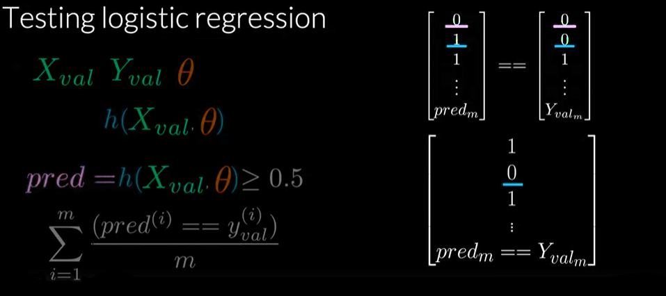

---

### Part 2: Sentiment Analysis with Naïve Bayes

#### 2.1 Conditional Probability & Foundations
- **Empirical Class Probability**:
  - Let event $A$ denote that a tweet is labeled positive ($\text{Pos}$). The prior probability of positive sentiment is:
    $$P(\text{Pos}) = \frac{N_{\text{pos}}}{N_{\text{total}}}$$
  - Complementary negative sentiment probability:
    $$P(\text{Neg}) = 1 - P(\text{Pos}) = \frac{N_{\text{neg}}}{N_{\text{total}}}$$
- **Conditional Probability Definition**:
  - The conditional probability $P(w \mid \text{Pos})$ is the probability that word $w$ appears given that the document has positive sentiment:
    $$P(w \mid \text{Pos}) = \frac{\text{freq}(w, \text{pos})}{N_{\text{pos}}}$$
  - 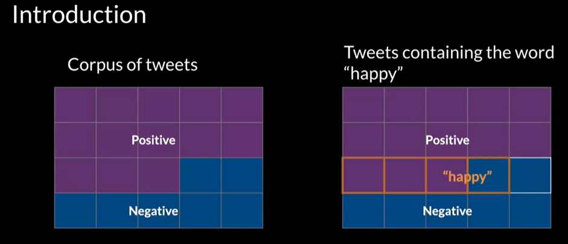
  - 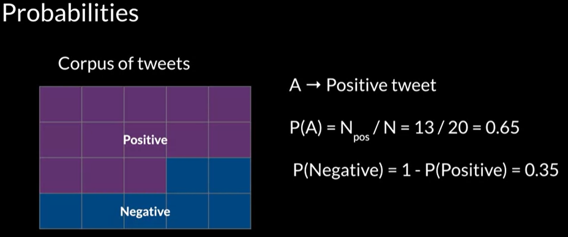

---

#### 2.2 Bayes' Rule for Text Classification
- **Bayes' Theorem Formulation**:
  - Relates conditional probability $P(X \mid Y)$ to its inverse conditional probability $P(Y \mid X)$:
    $$P(X \mid Y) = \frac{P(Y \mid X) \cdot P(X)}{P(Y)}$$
  - 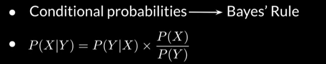
- **Application to Document Classification**:
  - For a document $d$ and class $C \in \{\text{Pos}, \text{Neg}\}$:
    $$P(C \mid d) = \frac{P(d \mid C) \cdot P(C)}{P(d)}$$
  - In practice, we evaluate the ratio of posterior probabilities:
    $$\frac{P(\text{Pos} \mid d)}{P(\text{Neg} \mid d)} = \frac{P(d \mid \text{Pos}) \cdot P(\text{Pos})}{P(d \mid \text{Neg}) \cdot P(\text{Neg})}$$
  - The evidence term $P(d)$ cancels out directly, eliminating the need to compute the document marginal probability.
  - 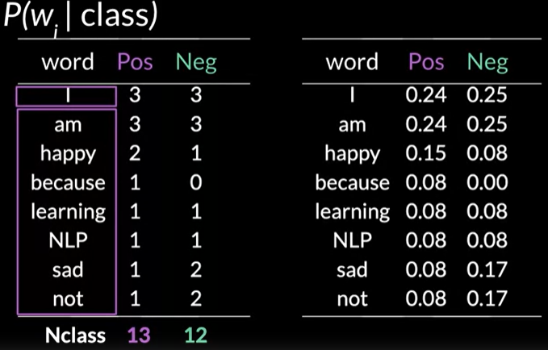

---

#### 2.3 Laplacian (Add-1) Smoothing
- **The Zero-Frequency Problem**:
  - If a word $w$ never appeared in positive training tweets, the maximum likelihood estimate gives $P(w \mid \text{Pos}) = 0$.
  - In a multiplicative probability model, a single zero probability forces the entire document likelihood $\prod_i P(w_i \mid \text{Pos})$ to $0$, overriding all other strong positive signals.
- **Laplacian Add-1 Smoothing Formulation**:
  - Add $1$ to every word count numerator and add $|V|$ (the total vocabulary size) to the denominator:
    $$P(w \mid C) = \frac{\text{freq}(w, C) + 1}{N_C + |V|}$$
    where $N_C = \sum_{w \in V} \text{freq}(w, C)$ is the total frequency of all words in class $C$, and $|V|$ is the number of unique words across both classes.
  - 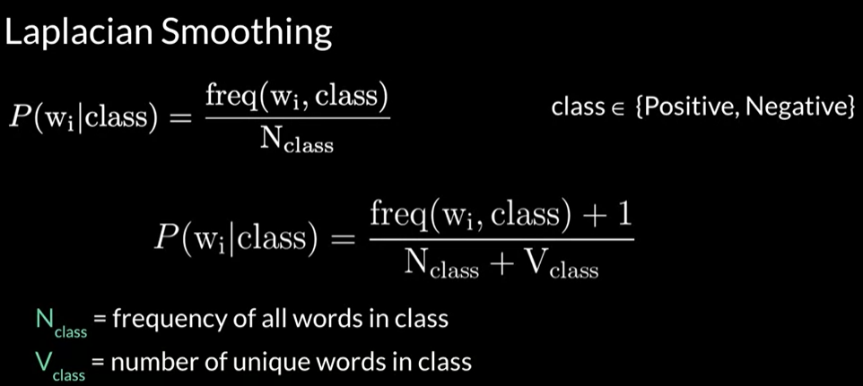
- **Conservation of Total Probability**:
  - Summing the smoothed probabilities across all words $w \in V$:
    $$\sum_{w \in V} P(w \mid C) = \frac{\sum_{w \in V} \text{freq}(w, C) + \sum_{w \in V} 1}{N_C + |V|} = \frac{N_C + |V|}{N_C + |V|} = 1$$
  - Every word has a strictly non-zero probability while ensuring a valid, normalized probability distribution.
  - 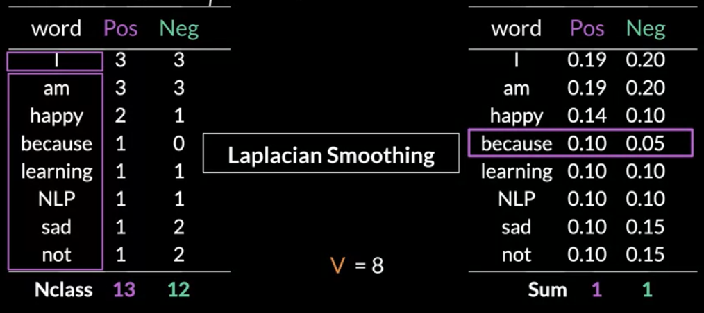

---

#### 2.4 Ratio of Probabilities & Likelihood Ratios
- **Per-Word Likelihood Ratio Definition**:
  - For each word $w$ in the vocabulary, compute the ratio of its smoothed positive probability to negative probability:
    $$\text{ratio}(w) = \frac{P(w \mid \text{Pos})}{P(w \mid \text{Neg})}$$
- **Interpretation of Ratio Values**:
  - **$\text{ratio}(w) > 1$**: Word occurs predominantly in positive tweets (e.g., "glad" $\to 4.0$, "great" $\to 3.5$).
  - **$\text{ratio}(w) \approx 1$**: Word is neutral and provides negligible discriminating power (e.g., "song" $\to 1.0$).
  - **$\text{ratio}(w) < 1$**: Word occurs predominantly in negative tweets (e.g., "sad" $\to 0.33$, "bad" $\to 0.25$).
- 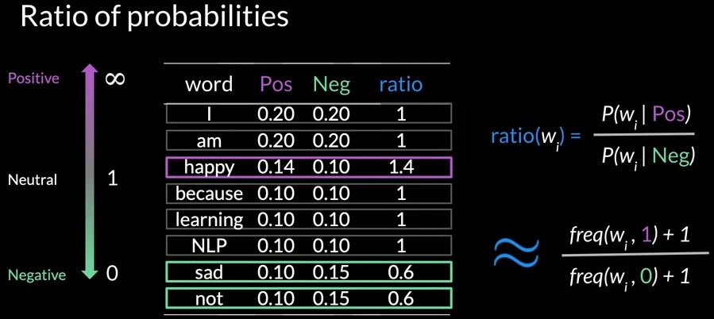

---

#### 2.5 Likelihood Product & Prior Odds
- **Naïve Bayes Multiplicative Formulation**:
  - Under the conditional independence assumption, the joint probability over all words $w_1, w_2, \dots, w_n$ in document $d$ factorizes as:
    $$\frac{P(\text{Pos} \mid d)}{P(\text{Neg} \mid d)} = \frac{P(\text{Pos})}{P(\text{Neg})} \times \prod_{i=1}^{n} \frac{P(w_i \mid \text{Pos})}{P(w_i \mid \text{Neg})}$$
  - $\frac{P(\text{Pos})}{P(\text{Neg})}$ represents the **Prior Odds**.
  - $\prod_{i=1}^{n} \frac{P(w_i \mid \text{Pos})}{P(w_i \mid \text{Neg})}$ represents the **Likelihood Ratio Product**.
  - If the product exceeds $1.0$, the tweet is classified as positive; otherwise, it is classified as negative.
- 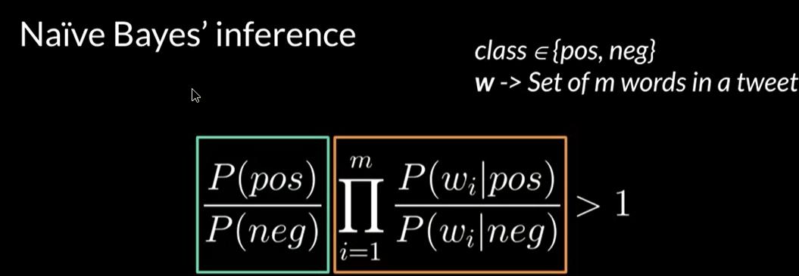

---

#### 2.6 Log Likelihood and Log Prior Formulation
- **The Problem of Numerical Underflow**:
  - Multiplying dozens of small probabilities ($p < 10^{-2}$) causes the floating-point product to underflow to zero, leading to loss of precision and erroneous zero division.
- **Logarithmic Transformation (Log Odds)**:
  - Applying natural logarithm converts products into sums:
    $$\log \left( \frac{P(\text{Pos} \mid d)}{P(\text{Neg} \mid d)} \right) = \log \left( \frac{P(\text{Pos})}{P(\text{Neg})} \right) + \sum_{i=1}^{n} \log \left( \frac{P(w_i \mid \text{Pos})}{P(w_i \mid \text{Neg})} \right)$$
- **Mathematical Components**:
  - **Log-Prior**:
    $$\text{logprior} = \log\left(\frac{P(\text{Pos})}{P(\text{Neg})}\right) = \log(N_{\text{pos}}) - \log(N_{\text{neg}})$$
    - For balanced training sets ($N_{\text{pos}} = N_{\text{neg}}$), $\text{logprior} = \log(1) = 0$.
  - **Log-Likelihood Weight $\lambda(w)$**:
    $$\lambda(w) = \log\left(\frac{P(w \mid \text{Pos})}{P(w \mid \text{Neg})}\right)$$
- **Classification Decision Rule**:
  - Compute total score:
    $$\text{score} = \text{logprior} + \sum_{i=1}^{n} \lambda(w_i)$$
  - Predict $\text{Pos}$ if $\text{score} > 0$; predict $\text{Neg}$ if $\text{score} < 0$.
- 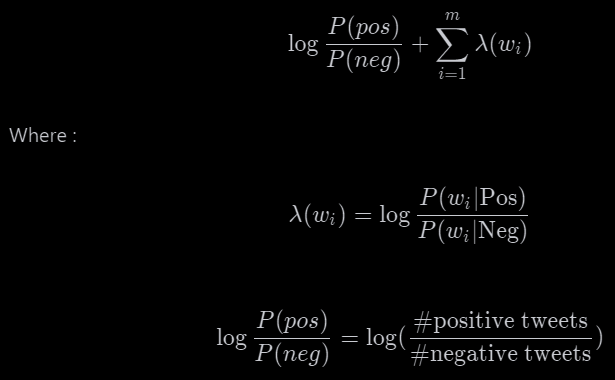

---

#### 2.7 End-to-End Training Algorithm for Naïve Bayes
- **Algorithmic Workflow**:
  - **Step 1: Collect & Label Dataset**: Prepare positive and negative training corpora.
  - **Step 2: Preprocess Tweets**: Apply lowercasing, regex URL/handle removal, tokenization, stopword filtering, and Porter stemming.
  - **Step 3: Build Frequency Dictionary**: Compute $\text{freq}(w, \text{pos})$ and $\text{freq}(w, \text{neg})$ for all tokens.
  - **Step 4: Compute Laplace Smoothed Probabilities**: Calculate $P(w \mid \text{Pos}) = \frac{\text{freq}(w, \text{pos}) + 1}{N_{\text{pos}} + |V|}$ and $P(w \mid \text{Neg}) = \frac{\text{freq}(w, \text{neg}) + 1}{N_{\text{neg}} + |V|}$.
  - **Step 5: Compute Log-Likelihood Ratios**: For each word $w \in V$, compute $\lambda(w) = \log(P(w \mid \text{Pos}) / P(w \mid \text{Neg}))$.
  - **Step 6: Compute Log-Prior**: Calculate $\text{logprior} = \log(N_{\text{pos}} / N_{\text{neg}})$.

---

#### 2.8 Testing, Inference & Scoring Algorithm
- **Inference on Unseen Tweets**:
  - Preprocess the input tweet into a list of cleaned tokens $[w_1, w_2, \dots, w_k]$.
  - Initialize $\text{score} = \text{logprior}$.
  - For each word $w_i$, lookup $\lambda(w_i)$ in the precomputed dictionary:
    - If $w_i \in V$, add $\lambda(w_i)$ to $\text{score}$.
    - If $w_i \notin V$ (out-of-vocabulary token), treat as neutral by adding $0$.
  - Output prediction: $\hat{y} = 1$ if $\text{score} > 0$, else $0$.
- **Validation Accuracy**:
  - Evaluate accuracy across the validation set ($X_{\text{val}}, Y_{\text{val}}$):
    $$\text{Accuracy} = \frac{1}{m_{\text{val}}} \sum_{i=1}^{m_{\text{val}}} \mathbb{I}(\text{pred}^{(i)} == y_{\text{val}}^{(i)})$$
- 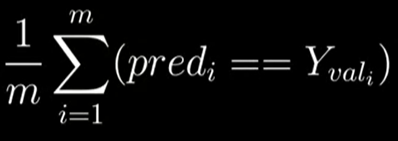

---

#### 2.9 Real-World Applications of Naïve Bayes
- **1. Sentiment Analysis**: Detecting consumer emotion and polarity in social media tweets, product reviews, and customer feedback.
  - 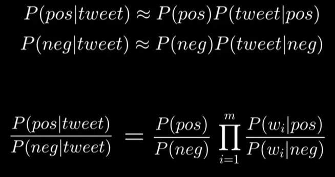
- **2. Author Identification & Stylometry**: Analyzing authorial writing style, lexical frequency distributions, and signature function words to attribute anonymous documents.
  - 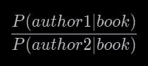
- **3. Spam Filtering**: Distinguishing legitimate emails from unsolicited commercial spam by identifying indicative trigger words and sender characteristics.
  - 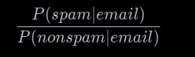
- **4. Information Retrieval & Document Classification**: Indexing web pages and articles into predefined categories (e.g., sports, finance, technology).
  - 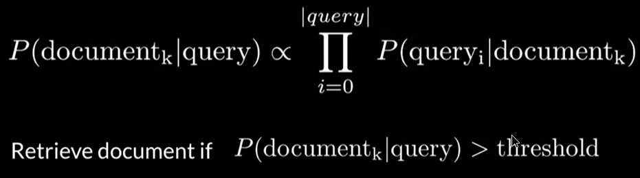
- **5. Word Sense Disambiguation**: Determining the correct contextual sense of ambiguous polysemous words (e.g., determining whether "bank" refers to a river bank or a financial institution based on co-occurring context words).
  - 

---

#### 2.10 Core Assumptions & Error Analysis
- **Core Naïve Bayes Assumptions**:
  - **Conditional Independence**: Assumes that words occur completely independently of each other given the class label: $P(w_1, w_2 \mid C) = P(w_1 \mid C) P(w_2 \mid C)$. In natural language, grammar and collocations violate this assumption, but Naïve Bayes performs surprisingly well as a classifier.
  - **Class Prior Distribution**: Assumes the training set class distribution mirrors the real-world operational distribution. Skewed training data requires calibrating the log-prior.
- **Common Sources of Error**:
  - **Lossy Preprocessing**: Aggressively removing punctuation can discard vital emoticons (`:)`, `:(`), and aggressive stopword removal can eliminate crucial negation tokens ("not", "never", "no").
  - **Word Order Insensitivity (Bag-of-Words Limitation)**: The model ignores word sequence and cannot distinguish:
    - *"I am happy because I did not go"* (Positive) vs. *"I am not happy because I did go"* (Negative).
  - **Adversarial Language & Figurative Nuance**: Sarcasm, irony, and litotes confuse bag-of-words models (e.g., *"This is a ridiculously powerful movie. The plot was gripping and I cried right through until the ending"*).

---

### Part 3: Vector Space Models & Word Embeddings

#### 3.1 Vector Space Models & Distributional Semantics
- **Conceptual Definition**:
  - Vector Space Models (VSMs) represent words, sentences, and documents as continuous numerical vectors in $\mathbb{R}^d$, capturing lexical and semantic relationships geometrically.
- **Distributional Hypothesis**:
  - J.R. Firth (1957): *"You shall know a word by the company it keeps."*
  - Words occurring within similar context windows share similar semantic profiles.
- **Primary Applications**:
  - Information retrieval, question answering, document clustering, semantic similarity search, and automated machine translation.
- 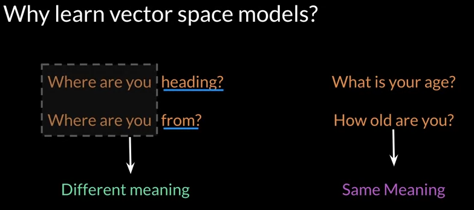

---

#### 3.2 Word-by-Word Co-occurrence Matrix Design
- **Matrix Construction**:
  - Define a symmetric context window of size $k$ (e.g., $k=2$ words before and after target word).
  - Count how many times word $w_i$ and word $w_j$ appear together within that window across the training corpus.
  - Produces a square co-occurrence matrix $M \in \mathbb{R}^{|V| \times |V|}$.
- **Semantic Interpretation**:
  - Row vectors encode specific contextual relationships between pairs of words, capturing semantic similarity directly from neighborhood overlap.
- 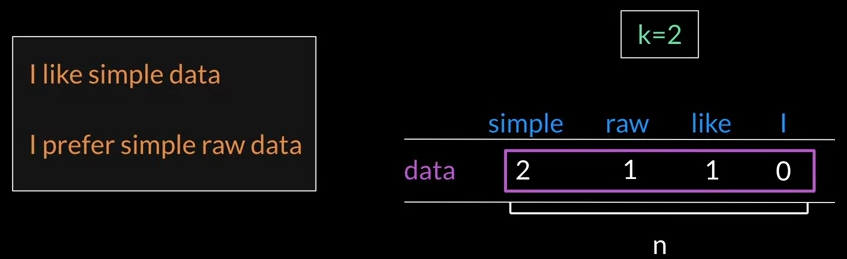

---

#### 3.3 Word-by-Document Co-occurrence Matrix Design
- **Matrix Construction**:
  - Tabulate how frequently each vocabulary word $w_i$ appears within each broad document category or topic $D_j$ (e.g., Entertainment, Economy, Space, Sports).
  - Produces a matrix $M \in \mathbb{R}^{|V| \times |D|}$.
- **Topical Embeddings**:
  - Words with similar category profiles (e.g., "planet" and "satellite" appearing predominantly in "Space") have similar row vectors.
- 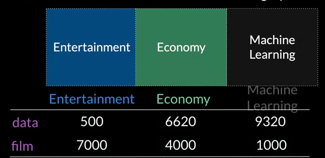

---

#### 3.4 Vector Distance Metrics: Euclidean Distance & Its Limitations
- **Euclidean Distance Definition ($L_2$ Norm)**:
  - Measures the straight-line geometric distance between two vectors $v, w \in \mathbb{R}^d$:
    $$d(v, w) = \|v - w\|_2 = \sqrt{\sum_{i=1}^{d} (v_i - w_i)^2}$$
- **The Document Length Dilemma**:
  - Euclidean distance is heavily sensitive to vector magnitude. If corpus A is short (100 words) and corpus B is long (10,000 words), both discussing the exact same topic, their word frequency vectors will have vastly different lengths, resulting in a large Euclidean distance.
- 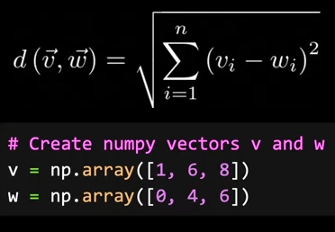

---

#### 3.5 Cosine Similarity & Angular Metric
- **Cosine Similarity Formulation**:
  - Computes the cosine of the angle $\beta$ between two vectors, effectively normalizing for vector magnitudes:
    $$\cos(\beta) = \frac{v \cdot w}{\|v\|_2 \|w\|_2} = \frac{\sum_{i=1}^{d} v_i w_i}{\sqrt{\sum_{i=1}^{d} v_i^2} \sqrt{\sum_{i=1}^{d} w_i^2}}$$
- **Properties & Scale Invariance**:
  - **Bounded Range**: For positive frequency counts, $\cos(\beta) \in [0, 1]$; for general zero-centered word vectors, $\cos(\beta) \in [-1, 1]$.
  - $\cos(\beta) = 1$: Vectors point in the identical direction ($\beta = 0^\circ$).
  - $\cos(\beta) = 0$: Vectors are orthogonal ($\beta = 90^\circ$), indicating no contextual correlation.
  - **Scale Invariance**: Multiplying a vector by any positive scalar does not alter the angle: $\cos(c \cdot v, w) = \cos(v, w)$ for $c > 0$.
- **Cosine Distance**:
  - Defined as $1 - \cos(\beta)$, providing a valid distance metric for ranking similarity.
- 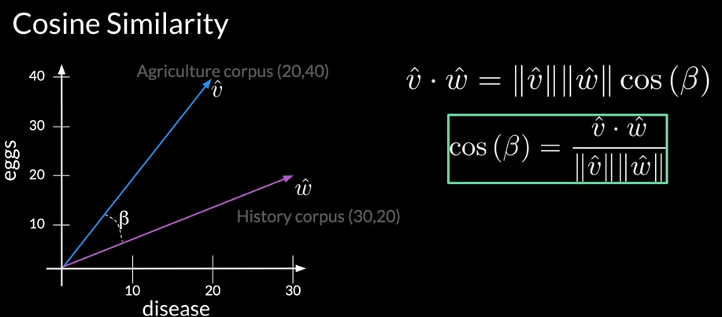

---

#### 3.6 Vector Space Manipulation & Semantic Analogies
- **Vector Arithmetic on Word Embeddings**:
  - Well-trained vector spaces encode linear relational semantics, allowing analogies to be computed via vector additions and subtractions:
    $$v_{\text{king}} - v_{\text{man}} + v_{\text{woman}} \approx v_{\text{queen}}$$
    $$v_{\text{Paris}} - v_{\text{France}} + v_{\text{Japan}} \approx v_{\text{Tokyo}}$$
- **Analogy Retrieval via Cosine Similarity**:
  - To answer analogy queries of the form $A : B :: C : ?$, compute target vector $v_{\text{target}} = v_B - v_A + v_C$.
  - Search the vocabulary for word $w$ that maximizes cosine similarity while excluding the input words:
    $$\arg\max_{w \in V \setminus \{A, B, C\}} \cos(v_w, v_{\text{target}})$$
- 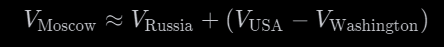

---

#### 3.7 Principal Component Analysis (PCA) Algorithm & Dimensionality Reduction
- **Motivation**:
  - Word embeddings reside in high-dimensional spaces (e.g., 300 dimensions). Visualizing relationships requires projecting vectors into 2D or 3D while preserving as much variance and semantic distance as possible.
- **PCA Step-by-Step Algorithm**:
  - **Step 1: Mean Center Data**: Subtract the feature mean so each feature has zero mean:
    $$X_{\text{norm}} = X - \mu$$
  - **Step 2: Compute Covariance Matrix**:
    $$\Sigma = \frac{1}{m} X_{\text{norm}}^T X_{\text{norm}}$$
  - **Step 3: Perform Singular Value Decomposition (SVD)**:
    $$\Sigma = U S V^T$$
    - $U \in \mathbb{R}^{d \times d}$ contains orthogonal eigenvectors (the principal component directions).
    - $S \in \mathbb{R}^{d \times d}$ is a diagonal matrix containing eigenvalues sorted in descending order, representing the variance along each principal axis.
  - **Step 4: Project Data onto $k$ Dimensions**:
    - Select the first $k$ columns of $U$ (denoted $U_{:, 1:k}$):
      $$Z = X_{\text{norm}} \cdot U_{:, 1:k}$$
  - 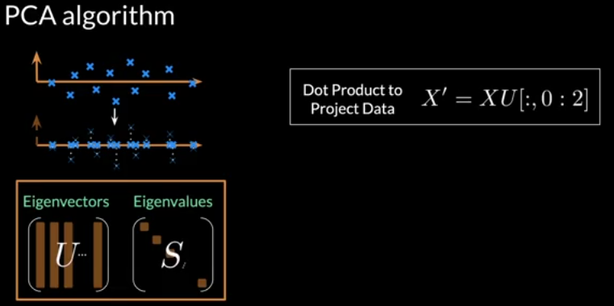
  - **Step 5: Compute Percentage of Retained Variance**:
    - Quantify information preserved by the first $k$ components:
      $$\text{Retained Variance} = \frac{\sum_{i=1}^{k} S_{ii}}{\sum_{j=1}^{d} S_{jj}}$$
  - 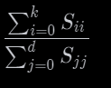

---

### Part 4: Machine Translation & Document Search

#### 4.1 Document Vector Representations
- **Document Embedding via Word Vector Aggregation**:
  - A document $d$ consisting of multiple words can be represented in the same continuous vector space as individual words by summing or averaging the embeddings of its constituent words:
    $$v_{\text{doc}} = \sum_{w \in d} v_w \quad \text{or} \quad v_{\text{doc}} = \frac{1}{|d|} \sum_{w \in d} v_w$$
- **Document Search**:
  - Documents and search queries reside in the same space, enabling fast similarity ranking via cosine similarity between query and document vectors.
- 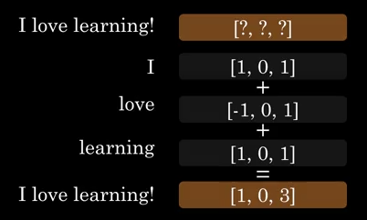

---

#### 4.2 Cross-Lingual Word Vector Transformation
- **Geometric Invariance Across Languages**:
  - Word embedding spaces for different languages (e.g., English $X$ and French $Y$) exhibit similar internal geometric relationships (e.g., numbers, animals, and colors form similar geometric clusters).
- **Linear Transformation Matrix $R$**:
  - For $m$ bilingual word pairs with English embeddings $X \in \mathbb{R}^{m \times d}$ and French embeddings $Y \in \mathbb{R}^{m \times d}$, find transformation matrix $R \in \mathbb{R}^{d \times d}$ such that:
    $$X R \approx Y$$
- 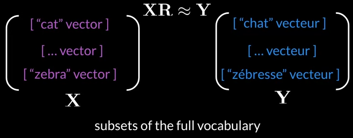

---

#### 4.3 Loss Function & Optimization (Frobenius Norm Loss)
- **Frobenius Norm Loss**:
  - The objective is to minimize the squared Frobenius norm loss between projected embeddings $XR$ and target embeddings $Y$:
    $$J(R) = \|XR - Y\|_F^2 = \sum_{i=1}^{m} \sum_{j=1}^{d} \left( (XR)_{ij} - Y_{ij} \right)^2$$
- **Gradient Computation & Weight Update**:
  - Compute the gradient with respect to transformation matrix $R$:
    $$\nabla_R J(R) = \frac{2}{m} X^T (XR - Y)$$
  - Update $R$ via gradient descent:
    $$R \leftarrow R - \alpha \nabla_R J(R)$$
- 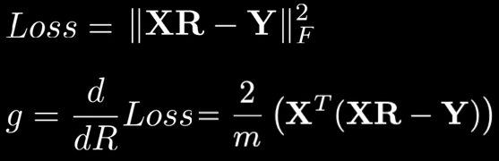

---

#### 4.4 K-Nearest Neighbors (KNN) & Search Bottlenecks
- **Translation Lookup via KNN**:
  - Given a new English word vector $x$, compute its predicted French embedding $\hat{y} = xR$.
  - Because $\hat{y}$ will generally not match any French word vector exactly, retrieve the closest actual French word vectors using K-Nearest Neighbors based on cosine similarity.
- **The Brute-Force Scalability Bottleneck**:
  - Exhaustive search requires computing cosine similarities across all $N$ words in the target vocabulary:
    $$\text{Time Complexity} = O(N \cdot d) \text{ per query}$$
  - For large vocabularies ($N \ge 10^6$ words), exhaustive linear search is too slow for real-time applications.

---

#### 4.5 Hash Tables and Basic Hash Functions
- **Hash Table Mechanics**:
  - A hash function maps objects into integer indices corresponding to buckets in a hash table, achieving $O(1)$ expected lookup time.
  - 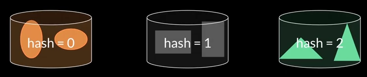
- **Basic Modulo Hash Function**:
  - Simple numerical hash function: $\text{Hash}(v) = v \pmod{\text{num\_buckets}}$.
  - 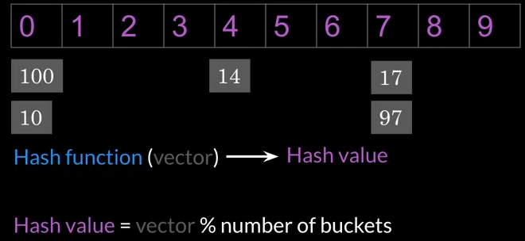
- **The Fundamental Limitation of Standard Hash Functions**:
  - Traditional hash functions intentionally distribute inputs uniformly across all buckets to prevent collisions. As a result, semantically similar vectors are scattered across completely different buckets, making standard hash tables unsuitable for nearest neighbor retrieval.

---

#### 4.6 Locality Sensitive Hashing (LSH) & Random Hyperplanes
- **Locality-Preserving Hashing**:
  - Locality Sensitive Hashing (LSH) designs hash functions such that similar input vectors are mapped to the same hash bucket with high probability.
- **Space Partitioning via Random Hyperplanes**:
  - Partition the continuous vector space using a collection of random hyperplanes passing through the origin.
  - Vectors lying in the same geometric region are assigned to the same bucket.
- 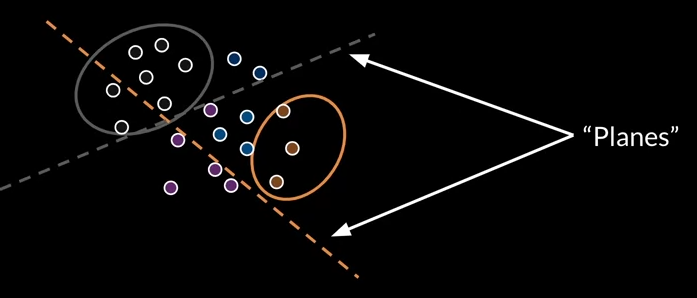

---

#### 4.7 Hyperplane Normal Dot Products & Binary Hash Encoding
- **Determining Vector Region via Normal Vectors**:
  - Each hyperplane $i$ is uniquely characterized by its normal vector $P_i$.
  - The sign of the dot product between vector $v$ and normal vector $P_i$ identifies which side of the hyperplane $v$ lies on:
    $$h_i = \text{sign}(v \cdot P_i^T) \ge 0 \implies 1, \quad \text{else } 0$$
- 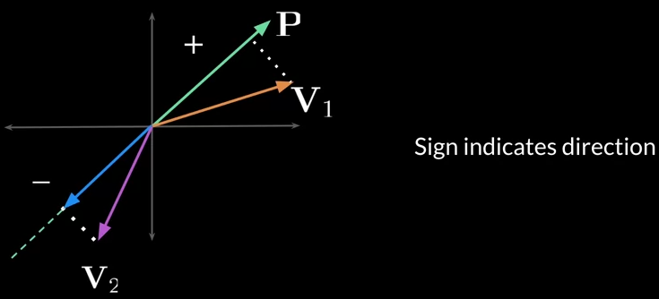
- **Binary Encoding & Unique Hash Key Generation**:
  - For $N_{\text{planes}}$ hyperplanes, each vector generates a binary signature $[h_0, h_1, \dots, h_{N_{\text{planes}}-1}]$.
  - Convert the binary sequence into a single integer bucket hash value:
    $$\text{hash\_value} = \sum_{i=0}^{N_{\text{planes}}-1} 2^i \cdot h_i$$
  - Partitions the vector space into $2^{N_{\text{planes}}}$ distinct spatial hash buckets.
- 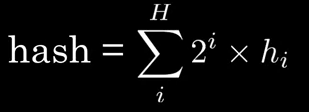

---

#### 4.8 Approximate Nearest Neighbors (ANN) & Multi-Table Search
- **Edge-Case Failure of Single-Table Partitioning**:
  - Two vectors that are extremely close to each other in vector space can fall on opposite sides of a hyperplane boundary, assigning them to different buckets and causing false negatives.
- **Multi-Table LSH Solution**:
  - Construct $L$ independent hash tables, each generated using an independent set of random hyperplanes.
  - 
- **Candidate Pooling & Fast Retrieval**:
  - At query time, hash the translated vector $\hat{y}$ into each of the $L$ hash tables.
  - Pool all candidate vectors found in the matching buckets across all $L$ tables into a combined candidate set.
  - Compute exact cosine similarities only over the pooled candidates rather than the entire vocabulary.
  - This delivers near-exhaustive recall accuracy while cutting retrieval latency by multiple orders of magnitude.
- 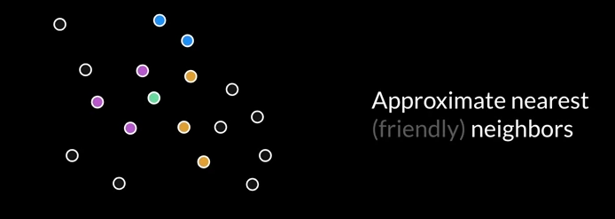

---

## 📄 License

This repository is licensed under the **MIT License**. See the [`LICENSE`](LICENSE) file for complete details.

---

## 🔗 Connect with Me

<div align="center">

[](https://mohdfaizy.vercel.app)
[](https://www.linkedin.com/in/mohd-faizy/)
[](https://github.com/mohd-faizy)
[](https://www.credly.com/users/mohd-faizy)
[](https://twitter.com/F4izy)
[](https://ai.stackexchange.com/users/36737/faizy)

</div>